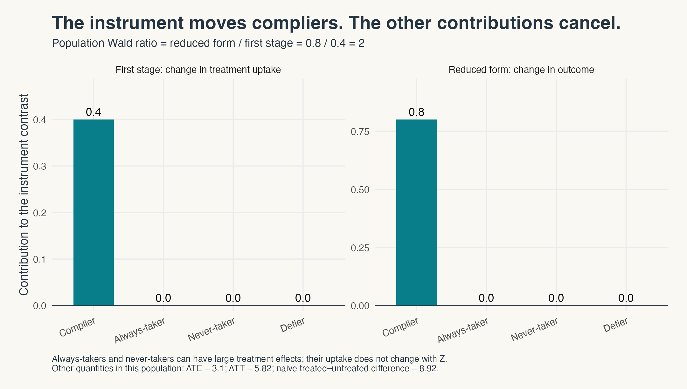
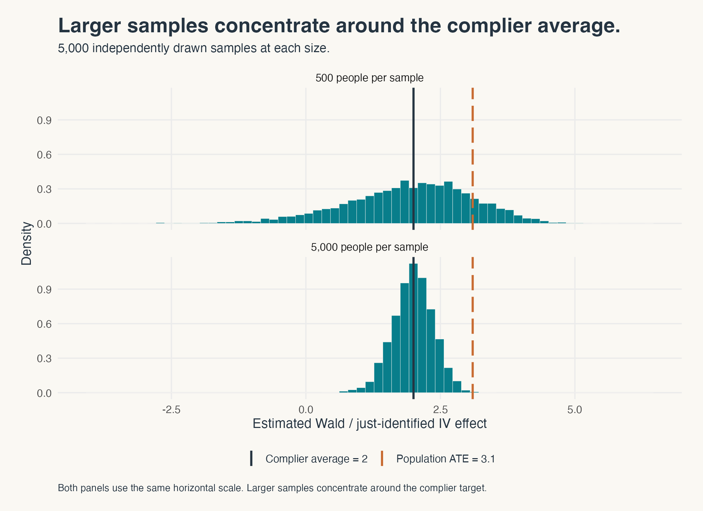
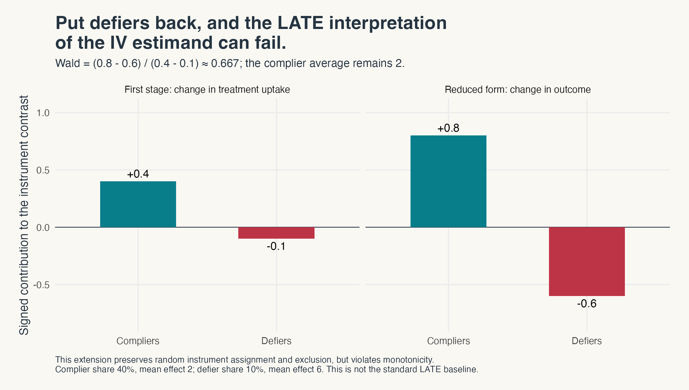

::: {.post-crosslink}
[Read on Substack](https://methodsmatter.substack.com/p/how-can-iv-identify-an-effect-for){.button}
:::

OK, folks, I must start by commenting on how much of a whirlwind my first post on pre-trends was---Whew, who knew that I touched on such a highly charged topic! It's no exaggeration that I may have stepped on a DID landmine! If I rocked your boat, I am sorry---no, just kidding! If you missed the first post, please check it out here: [Why are your pre-trends always parallel?](https://austindenteh.com/methods-matter/why-are-your-pre-trends-always-parallel/index.html)

> For my DID'sters, don't despair, I have multiple planned follow-up posts on DID, maybe including one on the sheer volume and range of responses the post generated! However, you'll need to wait just a bit more as I cook it---Chef Austin is at work! (If you're not familiar with the reference to the name I am shamelessly appropriating here, google "Why is Steph Curry called Chef Curry?") For now, I'd like to tell you a bit about LATE---I come in peace! 

::: {.reaction-gif}
{.reaction-media width=340 height=255 loading=lazy decoding=async fig-alt="Wile E. Coyote steps on dynamite, which explodes."}

*Chef Austin, stepping into the pre-trends debate.*

:::


I started teaching econometrics in Fall 2019 at Tulane University, my previous employer. Well, more accurately, the first metrics class I taught as a sole instructor of record was undergrad metrics in grad school in Spring 2016---wow, this means I have a decade of metrics teaching experience! I hadn't thought about it this way. In my first semester at Tulane, I taught undergrad/master's econometrics and followed up with PhD metrics in the second semester. When you teach metrics for a long time, you start to see patterns: what students easily understand and what they struggle with. If I were to try to summarize the latter, I'd easily say students tend to struggle with concepts that teach them how to learn about things we don't observe in the data or can't easily see in the data. You can call these things **latent** to various degrees. 

On teaching metrics, I am reminded of one conversation I was fortunate to have with Josh Angrist when he visited Tulane for the [Distinguished Lecture in Economics on May 6,
2024](https://murphy.tulane.edu/sites/default/files/2024-12/TheExchange-2024.pdf#page=49).
I asked him about his philosophy for teaching econometrics. My recollection
of his point is that he did not see much value in spending class time on
mathematical derivations, even in PhD metrics courses. He thought class time
was better spent engaging with the deep ideas and building intuition of why things work (or don't work).

At the time, I did not think that approach served students well. Over time,
I have come around to it. We should show important results and derive
some of those in class when it helps students understand what is going on.
But I increasingly think more of our class time should go to intuition,
with more of the derivations worked through in problem sets outside class.
Students need to understand what a result says, what conditions it requires,
and why those conditions matter.

That is also the approach I want to bring to these blog posts, with simulations
alongside the intuition. The intuition helps us understand why a result
works. The simulation lets us see it work in a population we made up and
see what changes when we introduce or remove an assumption.

> This post is about one such pain point for students---how do you think about estimating effects for a group you know exists but can't pinpoint in your data? Welcome to average effects for compliers, famously known as the local average treatment effect---LATE. 

I don't blame students for struggling with this concept. Let's see how best to break this one down. If you want to hear Josh Angrist talk about LATE, check out his Prize Lecture when he received the Sveriges Riksbank Prize in Economic Sciences in Memory of Alfred Nobel in 2021 (I need to write the prize in full so I satisfy the "economics doesn't have a Nobel prize" trolls): 

```{=html}
<div class="lecture-video">
  <iframe data-external="1" src="https://www.youtube-nocookie.com/embed/vEBUER-l0yQ?start=959" title="Joshua Angrist's 2021 Prize Lecture, starting at 15 minutes 59 seconds" loading="lazy" referrerpolicy="strict-origin-when-cross-origin" allow="accelerometer; clipboard-write; encrypted-media; gyroscope; picture-in-picture; web-share" allowfullscreen></iframe>
</div>
```

[Watch on YouTube from 15:59](https://youtu.be/vEBUER-l0yQ?t=959).

> For those who are in a hurry, here is the main point: **we can identify
> the average treatment effect for compliers without knowing which people
> in our data are the compliers.** The compliers are in
> the data even though we cannot tell which specific individuals they are.
>
> How does that work? Under the assumptions of independence of the instrument, exclusion restriction, no defiers, and a nonzero first stage, the instrument changes treatment levels
> only for compliers. Other types of people such as always-takers and never-takers can have very different
> treatment effects, **but their treatment does not change with the instrument**.
> Their contributions will cancel out when we do the outcome comparison to estimate the treatment effect. Then, dividing the
> outcome change by the first stage (change in treatment proportion) recovers the complier average treatment effect (LATE). 
>
> **Does that not make instrumental variable (IV) an estimate of the average effect for everyone? No.**
> In our example, the population IV ratio is 2 and the population ATE is 3.1. What happens when we relax the no-defiers assumption (by introducing defiers)? Well, even when random assignment and a
> positive first stage hold, the LATE interpretation can fail.
> **Your favorite metrics software can estimate the IV ratio even when the LATE
> interpretation isn't true.** Read on for the people, a little math, and the
> assumptions doing the work.

Suppose I tell you that my IV estimate is the average
treatment effect for compliers. You might be wondering: **who are
these compliers anyway?** Is it possible to show them in the data to you? No, not really. So, why do we claim that we can estimate their average treatment
effect? That should bother you enough to ask how this LATE interpretation works.

One answer is to recite the phrase **local average treatment effect**, or
**LATE** many times to you, and move on. I find that unsatisfying and students feel the same way too. 

So let's build a fake population ourselves. In this population, we will know everything about each person in it, including their treatment choice for each value of the instrument, and their individual treatment effect. Note that this never happens in the real world. Then we will conceal most of this information to mirror the fact that a researcher would not usually see all that info in their data. **After hiding this info, we will then see whether the IV estimator can recover the true average effect using only the information the researcher actually has access to.**

> **So, the compliers are in the data, but their type is hidden from the researcher.** This distinction is the starting point for correctly understanding LATE.

## Being offered treatment is different from taking it up

Imagine that a lottery (instrument) offers access to a program. Let our instrument $Z=1$ indicate someone receives the offer and $Z=0$ mean that they do not. Let the treatment $D=1$ mean that the person actually receives the treatment and $D=0$ mean that they
do not. These are different variables. In particular, treatment is not randomly assigned! People can decline an offer ($D=0, Z=1$), and some can obtain treatment without an offer ($D=1, Z=0$). 

Let $Y$ be the observed outcome, which is measured after the above decisions. The outcome can be anything such as a test score, earnings, or health care use.

For each person, let $D(0)$ denote whether they would receive treatment
without an offer (that is when the instrument $Z=0$) and let $D(1)$ denote whether they would receive treatment with an offer (that is when the instrument $Z=1$). Those two **potential treatment decisions generate four possible types of people in the population**:

::: {.compliance-types}
| Type | Without an offer: $D(0)$ | With an offer: $D(1)$ | Response to the offer |
|:---:|:---:|:---:|:---:|
| Complier | 0 | 1 | Takes up treatment only when offered |
| Always-taker | 1 | 1 | Takes up treatment either way |
| Never-taker | 0 | 0 | Never takes up treatment |
| Defier | 1 | 0 | Takes up treatment only without the offer |
:::

*Table 1. Treatment choices with and without an offer.*

We observe only one treatment choice for each person. Also, a binary instrument here means someone is offered access to a treatment (program) or is not. We do not get to observe both decisions for the same person in otherwise identical situations. 

That is why observing a treated person with an offer does not tell us that they are a complier. They might have taken treatment anyway without the offer. A person without an offer who remains untreated might be a never-taker, or might have taken treatment if offered it. **Even when we observe compliance with an assignment (i.e., $D=1, Z=1$ or $D=0, Z=0$, etc.), we do not know which of the 4 types of people the person is in the population.**

The word *complier* can also be confusing but it simply describes how treatment responds to a particular instrument. If we change the instrument, the people who end up being compliers can change.

This figure below provides a graphical way to view the transition from potential treatment and outcomes to observed data. Let $Y(0)$ and $Y(1)$ be the outcomes without treatment and with treatment, respectively. We will define treatment effects using them below. We know the person depicted in the figure below is a complier because we made up both treatment choices. The researcher only sees the highlighted path: "What the researcher sees" box. 



*Figure 1. Two possible instrument states for one illustrative complier. Only the highlighted path in the "What the researcher sees" box becomes an observed data row.*

## First, let us know everything

This is how I want to approach that teaching problem here: **let's start with information we would never have in a real dataset, then we'll take it away.**

Here is our constructed population. **Initially, there are no defiers (because we made it up so)---until section ["Now put the defiers back"](#now-put-the-defiers-back).**
We will bring them back later, when we examine what one of the identifying assumptions does.

::: {#baseline-types .baseline-types}
| Type | $D(0)$ | $D(1)$ | Population share | Mean effect |
|:---:|:---:|:---:|:---:|:---:|
| Complier | 0 | 1 | 40% | 2 |
| Always-taker | 1 | 1 | 35% | 8 |
| Never-taker | 0 | 0 | 25% | −2 |
| Defier | 1 | 0 | 0% | Absent in the baseline data |
:::

*Table 2. The types describe potential treatments under both values of the instrument.*

We defined **potential treatments** above ($D(0)$ and $D(1)$) and would now define **potential outcomes** to help us define treatment effects. Let $Y(0)$ be someone's outcome without treatment and $Y(1)$ their outcome
with treatment. Their individual treatment effect is
$\tau=Y(1)-Y(0)$. In our population:

| Type | Population share | Mean outcome without treatment | Individual treatment effects | Mean treatment effect |
|---|---:|---:|---|---:|
| Compliers | 40% | 1 | Half have effect 1; half have effect 3 | 2 |
| Always-takers | 35% | 5 | Half have effect 6; half have effect 10 | 8 |
| Never-takers | 25% | 0 | Half have effect −3; half have effect −1 | −2 |

People also have individual variation in their baseline outcomes. We add
the same mean-zero noise to both potential outcomes, so it does not change
their treatment effect. What matters here is that **effects differ both across types and among people of the same type!**

The lottery (the instrument or IV) independently offers each person access to the treatment with probability $0.5$. The lottery is unrelated to type, baseline outcomes, or treatment effects. Taking up treatment follows the decisions in Table 2. **Moreover, the offer itself has no effect on the outcome except through treatment.**

We can now calculate several quantities answering different questions because we created the population ourselves. The average treatment effect among compliers is 2. The average treatment
effect for the whole population, or **ATE**, is

$$
\operatorname{ATE}
=0.40(2)+0.35(8)+0.25(-2)=3.1.
$$

The average treatment effect among those who actually receive treatment,
or **ATT**, is about 5.82. That group includes all always-takers, whose average effect is 8, and the
half of compliers who receive an offer, whose average effect is 2. Those groups are 35% and 20% of the population, respectively, so the ATT is $\{0.35(8)+0.20(2)\}/0.55\approx5.82$. Never-takers have an average effect of −2, but they do not receive treatment and therefore do not enter this average. The composition of the treated group differs from the
whole population and from the complier population.

> Finally, **simply comparing observed outcomes for treated and untreated people gives about 8.92.** That is an outcome difference, and you can tell that's not one of these causal effects. **The treatment decision is not randomized just because the offer is, so you cannot learn about causal effects from this kind of naive comparison.** Among other differences, the always-takers have much higher outcomes without treatment and are always in the treated group. 

Here is the question: **when we hide the types and the potential outcomes (which is what happens in the real world anyway), which of these numbers will the IV method/estimator recover?**

## Now let's hide the labels from the researcher 

Let's give the researcher only three variables: (1) the offer $Z$; (2) observed
treatment $D$; and (3) observed outcome $Y$. The researcher cannot see anything else, i.e., the compliance labels, the unobserved treatment decisions, the individual effects, and the
unobserved outcomes.

There is an important note about saying that type is unobserved. If we rule out defiers (as we have done so far), some observed cells do reveal type. If someone without an offer ($Z=0$) ends up taking up the treatment, they must be an always-taker. Similarly, if someone with an offer ($Z=1$) ends up not taking up the treatment, this person must be a never-taker. **The other two cells (the first and fourth rows) remain mixtures of compliers and either always-takers or never-takers**:

| Observed cell | Possible types when there are no defiers |
|---|---|
| No offer, untreated | Compliers and never-takers |
| No offer, treated | Always-takers |
| Offer, untreated | Never-takers |
| Offer, treated | Compliers and always-takers |

In this example, no value of the instrument produces a cell
containing only compliers. This means we cannot pick the compliers out simply by checking their
$Z$ and $D$ values.


::: {.reaction-gif}
{.reaction-media width=340 height=169 loading=lazy decoding=async fig-alt="John Travolta looks around the room, puzzled."}

*Researcher, looking for the complier indicator in their data.*

:::


> That is where identification comes in. Could different unknown populations generate the same observed data we have at hand? If so, then the data alone will not allow us to learn anything because each of these possible unknown populations could have different complier average effects. So, we need assumptions that restrict those possibilities, allowing the data to help us learn about treatment effects. Assumptions are like magic bullets! When we simulate a fake world ourselves, we can build those magic bullets into the data generation process (DGP). Those assumptions do not immediately hold in any real data and must be defended on a case-by-case basis. **So, these restrictions help us identify the complier average (LATE) even though we don't know exactly who they are in the data.**

Indeed, one such magic bullet here is random assignment, which simply means that the groups defined by the instrument (groups $Z=1$ and $Z=0$) have the same distribution of types and potential outcomes in the population. This assumption lets us compare their average outcomes and treatment take up rates. Fun stuff! 

The **first stage** is the difference in treatment take up rates by instrument:

$$
\Delta_D=E[D\mid Z=1]-E[D\mid Z=0].
$$

Without the offer ($Z=0$), only the always-takers (35%) receive treatment. With the offer ($Z=1$), both always-takers and compliers receive it: 75% in
total. The first stage effect is therefore $0.75-0.35=0.40$.

The **reduced form** is the corresponding difference in mean outcomes:

$$
\Delta_Y=E[Y\mid Z=1]-E[Y\mid Z=0].
$$

The reduced form is $5.75-4.95=0.80$. This is the average effect of the instrument on the
outcome, sometimes called an intention-to-treat (ITT) effect.

For one binary instrument and one binary treatment, with an intercept
and no other covariates, the population IV coefficient is the **Wald
ratio**:

$$
\beta_W=\frac{\Delta_Y}{\Delta_D}
=\frac{0.80}{0.40}=2.
$$

There is the complier average effect. Did you notice that we have recovered it without labeling the compliers in the data? Isn't that cool? Huh? But this arithmetic alone doesn't really explain why the ratio has this LATE interpretation.

## Always-takers can have large effects and still cancel

Our always-takers have the largest mean treatment effect, which is 8. They are
also more than a third of the population. How can an outcome comparison
that includes so many of these always-takers recover an average of 2 (for compliers)?

Because **always-takers’ treatment does not change with the offer**. Always-takers are
treated in both instrument groups (see [Table 2](#baseline-types), where $D(0)=D(1)=1$). Random assignment gives the two groups the same distribution of always-takers in the population, and we also assume the offer (instrument) does not otherwise change their outcomes.
**The contribution of always-takers to the difference between instrument groups is zero. Their treatment effects themselves are not zero.**

The same logic applies to never-takers. Their mean treatment effect is
−2, but they are untreated under either instrument value (see [Table 2](#baseline-types), where $D(0)=D(1)=0$). They
contribute no outcome change to this comparison either.

This is where two of our magic bullets do their work: random assignment makes the groups comparable in the population; exclusion restriction means the instrument cannot change outcomes without changing treatment.

Compliers are different. The offer (instrument) changes their treatment from zero to
one. They are 40% of our fake population, with mean effect 2. Their
contribution to the average outcome change is therefore $0.40(2)=0.80$.

{width=2160 height=1224 loading=lazy decoding=async fig-alt="Only compliers contribute to the population first stage and reduced form in the baseline: 0.40 to the treatment-rate change and 0.80 to the outcome change. Always-takers and never-takers contribute zero to both contrasts."}

*Figure 2. Contributions to differences between instrument groups. Zero
contributions for always-takers and never-takers concern the instrument
contrast; they do not mean treatment has no effect on those people.*

A little more math makes the cancellation a bit more clear. Under the exclusion restriction, a
person's outcome under instrument value $z$ is

$$
Y(D(z))=Y(0)+D(z)\tau.
$$

Changing the instrument changes this outcome by
$\{D(1)-D(0)\}\tau$. Random assignment makes the observed population
outcome contrast equal to the average of this quantity. With no defiers,
$D(1)-D(0)$ is 1 for compliers and 0 for everyone else. Thus,

$$
\Delta_Y=P(C)E[\tau\mid C],
\qquad \Delta_D=P(C),
$$

where $C$ denotes the complier group. Dividing gives the population Wald ratio, $\beta_W$, defined above:

$$
\boxed{\beta_W=E[Y(1)-Y(0)\mid C].}
$$

> This is the part I want students to stay with a bit: **we have learned an
> average without learning who belongs to the group. Cool!**

::: {.reaction-gif}
{.reaction-media width=340 height=196 loading=lazy decoding=async fig-alt="Kronk smiles as he says, Oh yeah, it's all coming together."}

*We cannot show you the compliers, but we can isolate their contribution.*

:::


This is the key LATE theorem that Imbens and Angrist developed about 30 years ago 
[-@imbens1994]; see more on this by Angrist,
Imbens, and Rubin [-@angrist1996]. The word **local** refers to the people whose treatment changes under this instrument contrast. The compliers are 40% of our made up population. **The LATE is an average treatment effect for that group, which may not equal the average for the entire population.**

## Which assumptions made that work?

Let's carefully outline the key restrictions (magic bullets) that gave the observed ratio the LATE interpretation. Here you go:

1. **Independent instrument assignment.** This requires the instrument to be independent of potential treatment decisions and potential outcomes.
2. **Exclusion restriction.** The instrument affects the outcome only by changing treatment.
3. **Relevance.** The instrument changes the average probability of receiving
   treatment. Here, the first stage is 0.40.
4. **Monotonicity.** This is also called no-defiers and means that there's nobody who receives treatment when the instrument is turned off, but
   refuses treatment because the instrument turns on. That is, $D(1)\geq D(0)$ for
   everyone.

Beyond the above assumptions, we also need the usual assumptions such as no interference between people. If an offer changes someone else's treatment or outcome, we'll generally need to address that scenario with other methods. 

It's also important to note that randomizing an instrument doesn't get you the exclusion restriction or monotonicity. All of those are separate assumptions. Moreover, it's crucial to remember that we did **not** assume: homogeneous  treatment effects or even randomized treatment. The instrument is randomized but the treatment remains an endogenous choice people make. 

> We randomized the instrument, not treatment. **Random instrument assignment
> does not mean we automatically get the exclusion restriction to hold or that there are no defiers.**

## Does everything so far work when we have a finite sample from the population?

So far, we have worked with population quantities. In a finite sample, we can just 
replace the conditional means with sample averages among people who happened
to receive each instrument value. The sample Wald estimator is

$$
\widehat\beta_W=
\frac{\overline Y_{Z=1}-\overline Y_{Z=0}}
     {\overline D_{Z=1}-\overline D_{Z=0}}.
$$

In this case, two-stage least squares (2SLS) gives the same
coefficient as this sample Wald ratio. Mechanically, 2SLS first regresses the treatment on the instrument to get fitted values, then regresses the outcome on those fitted values.

Let's now repeatedly draw samples from our fake population and calculate this Wald ratio. We use 5,000 replications across two sample sizes: 500 and 5,000 people.

{width=1980 height=1440 loading=lazy decoding=async fig-alt="Sampling distributions of the IV estimator from repeated baseline samples at sizes 500 and 5,000, compared with the known complier average of 2 and population ATE of 3.1."}

*Figure 3. Independent samples from the same fake population.*

Across the 5,000 replications, the mean estimate is 1.92 for $n=500$
and 1.99 for $n=5{,}000$. Both the numerator and denominator of the IV ratio vary across samples. In a later post, we will delve into why IV can be biased in finite samples.

> Let's review two distinct ideas here. **Identification** says that the
population distribution of observed variables recovers the LATE under the above stated assumptions. **Consistency** is a property of the IV estimator, which says that, with repeated sampling from this fixed population and a nonzero first
stage, the IV estimator approaches that target as the sample grows. More data can make the IV estimate of the LATE more precise.

Could LATE equal ATE or ATT? Yes, in special cases! We will return to when these targets coincide in a separate post.

## Now put the defiers back into the game {#now-put-the-defiers-back}

We introduced four types of people, so why did we leave one (defiers) out of the above example? This is because the standard LATE argument needed monotonicity (no defiers) to go through; we ensured the DGP delivered exactly what the assumptions required.

But now that we have seen how IV works to get LATE, let's bring back defiers into the mix to muddy the waters. We would continue to keep 40% compliers and 35% always-takers. Let's reduce never-takers to 15% and add 10% defiers, each with treatment effect 6. We will maintain that the other 3 assumptions hold, i.e., independent $Z$, the exclusion restriction, and a strong first stage (relevance). The compliers still have a mean effect of 2.

**Defiers are people who refuse treatment when the instrument turns on ($D=0, Z=1$)**. The contribution of the defiers to the first stage is $-0.10$, and their contribution to the reduced form is $-0.10(6)=-0.60$. The positive complier contributions are
unchanged. Now:

$$
\Delta_D=0.40-0.10=0.30,\qquad
\Delta_Y=0.40(2)-0.10(6)=0.20,
$$

so the population Wald ratio is $0.20/0.30=2/3$.

> Take away the no-defiers magic bullet and the IV ratio becomes $2/3$---even though the instrument is still randomized, exclusion restriction still holds, and the first stage is positive and strong!

{width=2160 height=1224 loading=lazy decoding=async fig-alt="Adding 10 percent defiers and the Wald ratio becomes two-thirds, although the complier average remains 2."}

*Figure 4. Independent instrument assignment and exclusion restriction still hold, but
monotonicity fails. The Wald ratio combines complier and defier effects
with opposite signs.*

Notice what just happened. The Wald ratio gets you the IV estimand, but now this IV estimand fails to get us the LATE interpretation. Your estimation command can still produce a coefficient estimate. With enough data, your IV estimator/method can estimate $2/3$ very precisely. Can you still interpret this estimate as LATE? I'm afraid not! **What changed is the causal interpretation of that coefficient.**

More generally, with complier share $p_C$ and defier share $p_F$,

$$
\beta_W=
\frac{p_C\tau_C-p_F\tau_F}{p_C-p_F}.
$$

When $p_C>p_F$, the coefficient on the complier average exceeds one
and the coefficient on the defier average is negative. Here both groups have positive effects, 2 and 6, yet the ratio is smaller than either of them. Even a substantial positive first stage
did not rescue the LATE interpretation when defiers entered the picture. 


If these assumptions are all crucial for attributing the LATE interpretation to an IV estimate, how can we provide evidence for these assumptions? We will take up those questions in a later post.

::: {.reaction-gif}
{.reaction-media width=340 height=191 loading=lazy decoding=async fig-alt="A woman objects, That's not how this works. That's not how any of this works."}

*Random assignment plus a positive first stage. Still not enough!*

:::

## Closing thoughts: an identified average is not an identified list of people

The idea behind this post has two classic references: Imbens and
Angrist [-@imbens1994] and Angrist, Imbens, and Rubin [-@angrist1996]. The latter is especially
clear by laying out the four types and also applies the framework
to Vietnam-era military service and civilian mortality. The surprising feature of LATE is that members of a group we can't pinpoint (compliers) in the data can contribute to an observed comparison. Under the stated magic bullets, people whose treatment doesn't respond to the instrument cancel from that comparison. The remaining outcome change comes from
the compliers; the first stage tells us their population share. We can learn compliers’ average treatment effect without learning each complier's identity.

So, where does all the above leave us? Well, I think there are two practical questions we'll take up next. If complier membership is latent, how much can we still learn about their
characteristics? And once we add covariates, which conditional effects
are identified, and what does the IV regression
actually estimate?

Even if we identify LATE correctly (with assumptions and data), is it the "right" policy parameter you need? To learn more about this debate, see Heckman [-@heckman2010bridges] and Imbens [-@imbens2010better]. We will return to this question in a later post too. So much stuff to write about! 

::: {.subscribe-callout}
**More Methods Matter is on the way.** [Subscribe on Substack](https://methodsmatter.substack.com?utm_source=navbar&utm_medium=web) for the next messy business of applied research: from the pulpit to practice. 
:::

## References

::: {#refs}
:::
