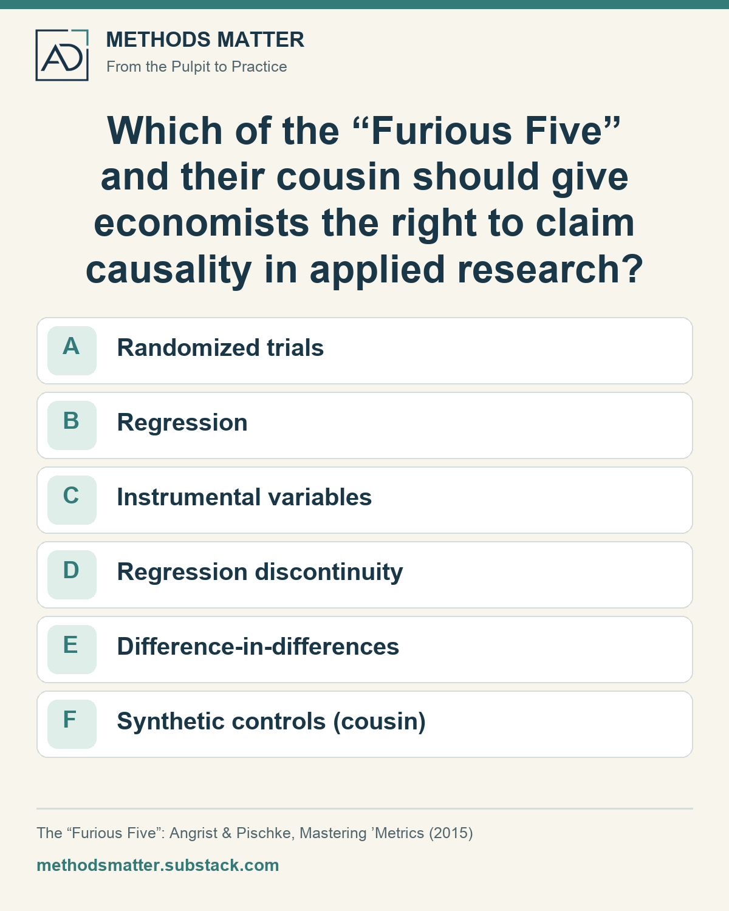
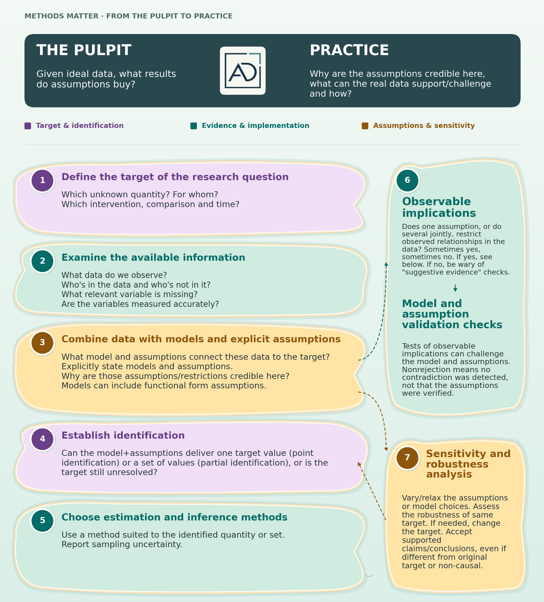
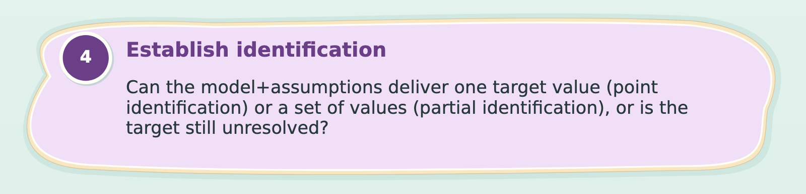
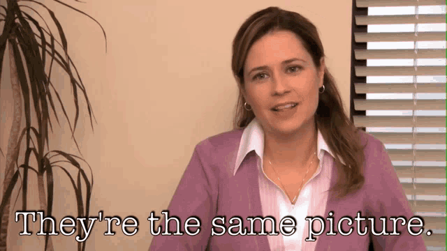
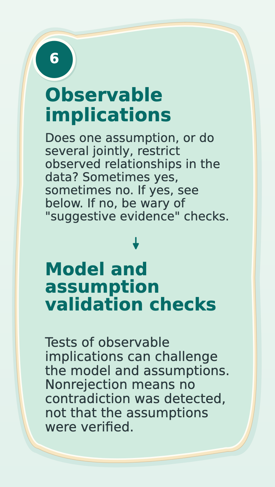
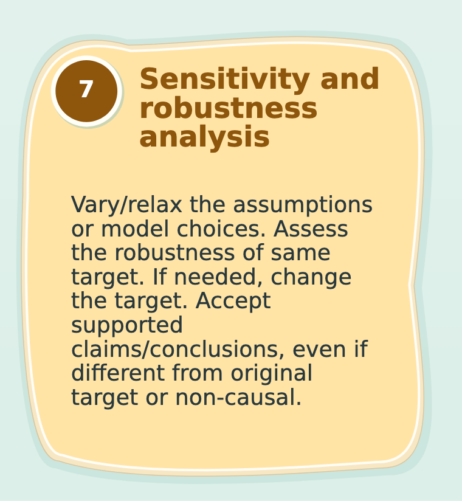

::: {.post-crosslink}
[Read on Substack](https://methodsmatter.substack.com/p/when-should-economists-make-causal){.button}
:::

> The art of the econometrician consists in finding the set of assumptions which are both sufficiently specific and sufficiently realistic to allow him to take the best possible advantage of the data available to him.

— Edmond Malinvaud (1966), quoted in Peter Kennedy,
[*A Guide to Econometrics*](https://www.blackwellpublishing.com/content/BPL_Images/Content_store/Sample_chapter/1405115025/Kennedy-001.pdf) [-@kennedy2003].

The above is my second [quote from Peter Kennedy's textbook on this blog](https://austindenteh.com/methods-matter/why-are-your-pre-trends-always-parallel/index.html), with this one attributed to the French economist Edmond Malinvaud. I read Peter's textbook in my master's program over a decade ago. Yet, I am still captivated by the clarity of his writing. Right before the above quote, he describes the econometrician's skill as wisely mixing two ingredients: "the input of sound and imaginative economic theory" and "the application of correct statistical methods." This post is about the latter skill. 

My first encounter with a "formal" causal inference course was in the fall of 2014, my second year of grad school at Georgia State University. I took a causal inference class with [Paul Ferraro](https://carey.jhu.edu/faculty/faculty-directory/paul-j-ferraro-phd), who's currently the Bloomberg Distinguished Professor of Human Behavior and Public Policy at Johns Hopkins University. Back then, I remember being very confused about most of the material we discussed, especially because I was also taking *Advanced Econometrics* on panel data with [Shif Gurmu](https://ays.gsu.edu/profile/shiferaw-gurmu/), now an emeritus professor. And every time I went between these two classes, I was surprised at how we were using regressions to recover causal effects in one, while in the other we were learning about regressions without really using the same causal language. I didn't know how to voice my frustration then, and I knew it had nothing to do with either professor either! 

In writing this post, I went back to Paul's causal inference syllabus, and I can see now that making these connections was part of what he wanted us to learn. The syllabus even says: "Even for students with substantial coursework in statistics, these connections are often missed." It was in this causal inference class that I conducted my first replication project. For my term paper, I replicated and extended a DID study by Yaa Akosa Antwi, Asako Moriya and Kosali Simon on the ACA's young adult mandate; this provision allowed young adults to stay on their parents' health insurance until age 26. As I waded through their replication code, I was fascinated by the sheer volume of decisions they had to make to prepare their data for analysis.

We were asked to replicate and extend a paper along one dimension, so I decided to add more follow-up data, change the age groups being compared, and use matching methods to pre-process the data before running the regressions. I hadn't looked at that term paper for over a decade, but as I glanced through the paper, I realized I was grappling with a few questions. **How would I know if the assumptions of their DID design were met? Would a different choice of comparison groups change the results and what would that even mean? If we can't know if the assumptions are met or not, should we still continue making the causal claims?**

> Since then, I think I've been trying slowly to better understand the way we use causality in economics. **I think we use causality too casually and that has recently started to bother me, and it is part of why I started this Methods Matter blog.**

> I am quickly coming to the conclusion that economists need to calm down a little with all the “this paper estimates the causal effect of X on Y” quasi-experimental studies. All these quasi-experimental methods have assumptions that are generally impossible to prove using data alone. **I believe the excessive need to still call conclusions from all such studies causal is wrongheaded. Every DID study doesn't need to lead to a "causal" conclusion. The same should apply to the other methods. Yes, I know those methods deliver causality in theory, but the practical business of implementing these methods is so messy that we should become more humble and back down from causal attribution with all such studies**. 
>
> What should happen then? If we are unable to "convince ourselves" (as Dan puts it below) about the validity of these assumptions, which happens more often than you think, I claim we should become comfortable letting those difficulties change what we claim in such studies using these methods. DID studies should be OK saying, yes, we know DID can deliver causal effects in theory but we are only comfortable describing our effects as correlations. And editors and referees need to become comfortable with that too. Otherwise, we are asking researchers to ignore the messiness, often "beating the data" to dress it up in a way that looks like causality can still be assured. For DID, this has led to the strange status quo, where almost every published DID paper displays flat pre-trends, as I described in my very first post [here](https://austindenteh.com/methods-matter/why-are-your-pre-trends-always-parallel/index.html).

As is becoming my custom, I created [a LinkedIn poll](https://lnkd.in/p/ed-BPerQ) asking which methods should give economists the right to claim causality in applied research.

::: {.poll-context}

[{width=480 height=600 loading=lazy decoding=async fig-alt="LinkedIn poll asking which of the Furious Five and their cousin should give economists the right to claim causality in applied research. Options: A randomized trials; B regression; C instrumental variables; D regression discontinuity; E difference-in-differences; F synthetic controls, the cousin."}](https://lnkd.in/p/ed-BPerQ)

Here's the poll that prompted this discussion. [View the post and comments on LinkedIn](https://lnkd.in/p/ed-BPerQ).

:::

Not surprisingly, [Dan Millimet](https://people.smu.edu/dmillimet/) was the first to comment and he rightly pushed back on the framing. Here is his first comment (emphasis added):

> Austin... you know better. any method applied to applications where the assumptions hold and thus allow for consistent estimation of a causal parameter gives one the right. you get to claim causality because you chose a specific method, **you get to claim it when you convince yourself and the reader that the assumptions required hold in your specific application.** questions like this reinforce the misconception that some estimators inherently "work" and others inherently "suck" (although, yeah, DID inherently sucks  🙃 )

**But how would we truly ever know our assumptions hold?** Dan's later conclusion was even stronger:

> “anyone who doesn’t understand and agree with my response has not been properly educated and should not be let near data 😉”

One question I keep coming back to these days is: **how do we provide evidence for the validity of assumptions based on data? Moreover, what if the data can provide no such assurance of validity?** This question has been running through my first two posts, which covered [DID](https://austindenteh.com/methods-matter/why-are-your-pre-trends-always-parallel/index.html) and [IV](https://methodsmatter.substack.com/p/how-can-iv-identify-an-effect-for) methods. A big part of the economics profession now purports to use quasi-experimental methods to learn causal effects from observational data. 

By a **quasi-experimental study**, I mean a study that tries to learn a causal effect without directly randomizing the treatment. The leading methods in this regard are largely DID, IV, RD methods, and Synthetic controls. Angrist and Pischke's *Mastering 'Metrics* includes “instrumental variables, regression discontinuity designs, and differences-in-differences” among its “Furious Five” [@angristpischke2015, p. xiv].

In addition, I think that most applied people don't always think about estimation in the way an econometrician would have them do. I think it's probably how we train grad students, but most of the inappropriate use of methods/estimators, including claims made with data, has to do with a lack of clear separation of the roles of identification, estimation, and inference. This isn't really a new insight, but I have been thinking of the best mental picture to illustrate this point. We can spend a great deal of time improving a regression, but doing so often doesn't address the question of why its coefficient should be the effect we wanted in the first place. **Regressions are cheap, but what do you learn if the needed assumptions cannot be provably met?**

> To summarize for those who need to go at this point, here is my main point: **we should become comfortable using DID, IV or RD without insisting that every such study has found a causal effect.** Say a researcher has done the work and still cannot defend the causal interpretation. I don't think that paper should have to end by forcibly announcing a causal effect. If admitting the unresolved problem gets it rejected, we have given the researcher a reason to hide the problem. Remember, we can never provably claim these quasi-experimental assumptions ever fully hold in our data. 
>
> In [Post 1](https://austindenteh.com/methods-matter/why-are-your-pre-trends-always-parallel/index.html), the missing untreated outcome remained missing even with perfectly parallel pre-trends. In [Post 2](https://methodsmatter.substack.com/p/how-can-iv-identify-an-effect-for), our IV estimand stopped being the effect for compliers once we introduced defiers, although we could still estimate the estimand. We need to understand what our data and assumptions let us learn, then choose how to estimate it and account for uncertainty. **Some assumptions have implications we can test; others do not**. What can we learn if a doubtful assumption is relaxed? We may still have a useful answer, perhaps a range under stated restrictions. **And more often than not, the causal question remains unresolved. I believe this happens more often than we care to admit and we should be able to say so freely in our papers and not be beholden to "causal claims."**

## Are we even standing on the same island? {#learning-islands}

> Estimation is learning about unknown things from data. We need to think of the estimation task as an exercise in first choosing a target parameter of interest in a well-defined population, then working backwards to the data (sometimes rich, other times more imperfect) to see what we can learn about it. Often the data alone cannot provide a reasonable estimate of that parameter, so we need to pair data with assumptions (some testable, others not), and choose the estimation method informed by those assumptions. The art of econometrics is the interplay of all these things. **I think this is a major source of confusion in applied work, although the particular confusion varies from method to method.**

I have tried to separate these issues in the figure below. I'm calling the numbered places **islands**. **When people talk past each other, I think it's likely because they are standing on different islands.** You can move back and forth between islands as you learn more about the research context or discover what is in your data. I debated adding arrows, but ended up with no arrows marching you through islands 1 to 5. I want us to have names for the different things, but there's no linear recipe for how to move between these islands or use this mental picture in general.

{width=2240 height=2480 loading=lazy decoding=async fig-alt="Seven numbered islands in a causal argument to answer a research question, framed by the pulpit question of what follows under assumptions and the practice question of why they are credible here. Islands 1 through 5 concern the target, available information, explicit assumptions, point or partial identification, and estimation and inference. Island 6 concerns observable implications and model and assumption validation checks; island 7 concerns sensitivity and robustness analysis. There is no linear recipe for moving between these islands."}

*Figure 1. Different jobs in learning from data. The islands represent places to visit and revisit in the course of answering the research question with data.*

Suppose our research question is: **what is the effect of enrolling in Medicaid on emergency room (ER) visits?** Let us first look at what we actually have in the data (**island 2**). People may enroll in Medicaid through several eligibility routes, but suppose our data records enrollment through only one route. A person with no enrollment in that file could still have Medicaid through another route. If treatment means Medicaid enrollment through any route, coding that person as untreated gets their treatment status wrong. **Measurement problems are pervasive and under-appreciated in practice.**

## We have an IV estimate. Which effect did we want in the first place?

Now return to our question about Medicaid and ER use and suppose our context is the [Oregon Health Insurance Experiment](https://www.nber.org/oregon). The Oregon experiment first randomized who had the opportunity to apply for Medicaid via a lottery, and some of the lottery winners went on to enroll in Medicaid. **Do we want an answer for all lottery-eligible adults, or would an answer for a subset of them be enough for our purposes?** How are people getting Medicaid? Are we interested in Medicaid enrollment itself or in the lottery effect? **Stating the population and intervention (treatment) is part of defining the target parameter** (island 1). 

> What may seem strange is that since the publication of Imbens and Angrist [-@imbens1994], researchers basically now just use an IV model, and implicitly assert they care about LATE (like all the Oregon experiment papers, including mine). I don't see how we come back from this status quo easily, so for now, let's just say our target parameter is the LATE.

Remember the compliers: they would enroll if they won the lottery, but would stay out if they lost the lottery. LATE averages the effects for these people. **Local** reminds us that we defined the group by its response to this particular lottery. An average for all eligible people, or for everyone who enrolled, is a different target and can have a different value. In [the previous post](https://methodsmatter.substack.com/p/how-can-iv-identify-an-effect-for), we made the complier average 2 and the average for the whole population 3.1. If we wanted the whole-population effect, recovering 2 would not answer our question. 

If we say we are indeed interested in the LATE, then we introduce a model and assumptions to help us learn about it. The model here is the heterogeneous causal effects model of Imbens and Angrist [-@imbens1994], with its associated assumptions, which we covered in the [previous post](https://methodsmatter.substack.com/p/how-can-iv-identify-an-effect-for). We put all of those on **island 3**, and then ask what they identify on **island 4**. Do the assumptions and observed population distribution pin down the effect? This question is about the population, even if we are eventually going to estimate the effect with a sample.

Let the instrument $Z$ indicate the lottery, treatment $D$ indicate actual Medicaid enrollment, and $Y$ be the outcome. The population Wald ratio compares the mean outcome difference between lottery winners and losers with their difference in enrollment rates:

$$
\beta_W=
\frac{E[Y\mid Z=1]-E[Y\mid Z=0]}
     {E[D\mid Z=1]-E[D\mid Z=0]}.
$$

We can calculate the IV ratio (Wald estimate) when both instrument groups are observed and the denominator is nonzero. But why does it give us the LATE? This argument is more fully developed in [this IV post](https://methodsmatter.substack.com/p/how-can-iv-identify-an-effect-for). 

Now, when we are satisfied that the model/assumptions and the population distribution give us the LATE of insurance, we still need to estimate it from a sample (**island 5**). We won't generally get the population value exactly, so we need to account for sampling uncertainty. We can choose the 2SLS estimator to estimate the IV estimand, with appropriate inference procedures to account for sampling uncertainty. **To reiterate, why should this estimated IV coefficient be the LATE in the first place? We needed the identification assumptions and argument to answer that question.**

What if we get a very high first-stage F-statistic? Give us an F above 10, or if you like above 100, and we start to feel comfortable like we have arrived. The relevance condition is easily checked from the data. **But what happened to the other assumptions we just said were required?** Weak instruments can cause serious problems with estimation and inference, and that is why we need the weak instrument literature. What is often forgotten is that a strong first stage does not make exclusion restriction or no defiers more plausible based on data. 

::: {.reaction-gif}
{.reaction-media width=320 height=265 loading=lazy decoding=async fig-alt="Michael Scott smiles and gestures in celebration."}

*The first stage passed. We may have celebrated too soon.*
:::

Remember what happened when we [put defiers back into our made-up population](https://methodsmatter.substack.com/p/how-can-iv-identify-an-effect-for). The lottery was still independently randomized, exclusion restriction still held, and treatment still increased on average following the lottery. The compliers still had an average effect of 2, yet the Wald ratio (IV estimand) was $2/3$. Suppose we could observe the whole population and compute this IV ratio exactly. We would have $2/3$, smaller than the complier effect (LATE) of 2. **The Wald ratio is no longer equal to the effect we wanted.** This is what removing no defiers did to our identification argument.

> I can give you an example of what defending an assumption looks like from my own work. In my Oregon paper with Helge Liebert, we call no defiers "reasonable, especially given the fact that the lottery was based on a sign-up list" [-@dentehliebert2025, p. 8]. I know this argument is inadequate, and this is the kind of thing I am asking us to wrestle with in our own papers.

Now remember what we called treatment in this paper: ever enrolling in Medicaid during the study period, including through other possible programs. Say a person would enroll in Medicaid if they lost the lottery. What does no defiers require for this person? They must also end up enrolled if they won the lottery. We cannot watch the same person make both choices; so, this is our maintained, untestable assumption. No defiers concerns eventual enrollment through any of those routes. Our no-defiers argument has to concern that full enrollment decision. **A high F-statistic does not help us make the no-defiers argument.**

## Back to the flat pre-trends

This takes me back to that ACA term paper. I could add new data and try a different age group as the comparison group, but I still couldn't observe what the treated young adults would have done without the provision.

In [my first DID post](https://austindenteh.com/methods-matter/why-are-your-pre-trends-always-parallel/index.html), I questioned what we can learn from a flat pre-trends graph. To rehearse the DID version of this confusion, suppose a program begins between two dates, 0 and 1. Let $G=1$ denote the eventually treated group, and $G=0$ denote a comparison group. Date 0 is our pre-treatment reference and date 1 is the post-treatment date. We want the average effect at date 1 for the people who received treatment, or the **ATT**.

Use $Y_t(0)$ to denote the potential outcome at date $t$ if treatment was set to $0$, and $Y_1(1)$ to denote their date-1 outcome if treatment was set to $1$. Our target parameter is

$$
\operatorname{ATT}_1=E[Y_1(1)-Y_1(0)\mid G=1].
$$

In the ATT above, we are comparing two quantities for the same treated person at the same date, i.e., their outcomes with the treatment and their outcomes without it. Of course, only the first is observed (i.e., $E[Y_1(1)\mid G=1]$). So, what do we plug in for the second? We could use the untreated group's outcome at date 1, but those are different people, and the groups could have differed even without the program. We could instead use the treated group's own outcome at date 0. Now we have the right people, but at the wrong date! Their outcomes could have changed between 0 and 1 without receiving the program. This is the problem we are trying to solve with DID.

For this comparison, maintain **no anticipation**: the program has no effect before it begins. Define the treated-minus-comparison gap in mean untreated potential outcomes as

$$
\delta_t=E[Y_t(0)\mid G=1]-E[Y_t(0)\mid G=0],\qquad t=0,1.
$$

Under those conditions, the population difference-in-differences satisfies

$$
\begin{aligned}
\Delta_{\mathrm{DID}}
&=\{E[Y_1\mid G=1]-E[Y_0\mid G=1]\}
 -\{E[Y_1\mid G=0]-E[Y_0\mid G=0]\}\\
&=\operatorname{ATT}_1+\delta_1-\delta_0.
\end{aligned}
$$

::: {.island-snapshot .island-snapshot-identification}
[{width=1600 height=387 loading=lazy decoding=async fig-alt="Detail from Figure 1: Island 4, Establish identification. Ask whether the model and assumptions deliver one target value, a set of values, or leave the target unresolved."}](#learning-islands)

*Island 4: detail from Figure 1.*
:::

**This DID estimand equals the ATT if $\delta_1=\delta_0$.** We are assuming that, absent treatment, the two groups would have experienced the same average change between dates 0 and 1. This is the **post-period parallel trends condition needed for this target**. In the equation, it makes the last two terms cancel, leaving us with the ATT. We can then estimate that comparison with our sample. 

> Dear DID’sters, remember what we assumed to get there: **an equality involving the treated people's date-1 outcome without treatment, the very thing we cannot observe**. Oh, DID’sters! 

Now suppose we have many earlier dates, and the population pre-trends are perfectly parallel. (I will not even touch on the fact that we can engineer these flat pre-trends ourselves.) We know that the untreated group gap stayed the same throughout those earlier dates. All of that happened before the program began. So, for our date-1 comparison, we need the untreated gap at date 1 to equal the gap at date 0. We cannot observe the treated group's potential outcome at date 1, **so pre-treatment equalities don't prove anything.** Using these pre-treatment equalities requires an argument connecting the two. This was my argument in [Post 1](https://austindenteh.com/methods-matter/why-are-your-pre-trends-always-parallel/index.html). Kahn-Lang and Lang [-@kahnlang2020] explain why parallel pre-trends are neither necessary nor sufficient for the relevant post-period condition; Ghanem, Sant'Anna, and Wüthrich [-@ghanem2026] investigate the connection through selection into treatment.

In [Post 1](https://austindenteh.com/methods-matter/why-are-your-pre-trends-always-parallel/index.html), I gave a simple example. Suppose the observed group gap is zero before treatment and 1 afterward. One explanation is that the untreated gap would have stayed at zero, and treatment raised the treated group's outcomes by 1. Another is that treatment had no effect, and the untreated gap would have risen by 1 anyway. We observe the same thing in both cases, yet the ATT is 1 in the first and zero in the second. If you run DID, you will get the same comparison in either case. **You can show the pre-trends and the post-treatment estimates, and we still won't know which case we have. The missing counterfactual remains missing.**

::: {.reaction-gif}
{.reaction-media width=340 height=191 loading=lazy decoding=async fig-alt="Pam Beesly says, They're the same picture, in The Office."}

*Same observed comparison. Different answers about the effect.*
:::

Suppose your argument is that the treated-minus-comparison gap in untreated outcomes would continue its earlier trend after treatment begins. With flat population pre-trends, that model would give you a flat untreated post-treatment gap too. **But the continuation is something you have assumed about the untreated future. It is not another feature that came by default with your pre-trends graph. Tell us why that model fits this application.** That is work on the assumptions island.

> So, in both examples we can calculate something from the observed data, but we want that something to be a particular causal effect. The identification argument tells us why the two are equal under the assumptions. **When we put defiers into the IV example, that equality failed even though we could still estimate the ratio. With DID, the comparison can similarly be estimated well while the post-period parallel trends assumption fails.** This is why I want us to separate identification from estimation. We could have estimated the comparison quite well and still failed to learn the causal effect we set out to learn. In this case, should the economist still say they got a causal effect from a quasi-experiment? How would you know, economist?

## What can the data push back against?

Models and assumptions vary widely in what they restrict, often concerning things we do not observe in the data. Some assumptions have **testable implications** on their own and others do not. And sometimes groups of assumptions have testable implications together (**island 6**).

> Testing becomes more useful when we have clear observable implications to examine. But testing testable implications is far too scarce in applied research. And I'll return to testable implications in later posts. **If an assumption has no such implications on its own, we cannot test it on its own.** Regardless, the researcher needs to understand what the tests can show them and what they'll just need to humbly live with. That also brings us to robustness analysis (**island 7**): what can we still learn if we relax an assumption? Sometimes when we relax assumptions, the earlier chosen target can change. We ought to keep readers informed about whether the target remains the same or not when we change or relax assumptions.

:::: {.island-snapshot-pair #islands-testing-pair}

::: {.island-snapshot .island-snapshot-checks}
[{width=760 height=1341 loading=lazy decoding=async fig-alt="Detail from Figure 1: Island 6, Observable implications and model and assumption validation checks. Tests can challenge the model and assumptions; nonrejection means no contradiction was detected, rather than verification."}](#learning-islands)
:::

::: {.island-snapshot .island-snapshot-sensitivity}
[{width=760 height=824 loading=lazy decoding=async fig-alt="Detail from Figure 1: Island 7, Sensitivity and robustness analysis. Vary or relax assumptions and model choices, assess robustness, and accept the supported conclusions."}](#learning-islands)
:::

*Islands 6 and 7: details from Figure 1.*
::::

Say our IV model and assumptions jointly specify a particular observable pattern in the data. We can test that restriction using our data. The null hypothesis is that the observable restriction holds in the population; the alternative is that it is violated or refuted. Rejecting that null provides evidence against the restriction and, therefore, against the model and assumptions that imply it. If we fail to reject the null, what have we learned? Well, the data at hand provide insufficient evidence to detect a contradiction, which could mean our data are compatible with the model/assumptions or we have insufficient power.

The two examples give us quite different things to do on the testing island. In the IV example, independent assignment, exclusion restriction and no defiers together rule out some patterns in the observed data. We can look for those patterns and ask whether the data contradict what the assumptions jointly imply. In the DID example, the post-period parallel trends assumption does not require the earlier group gaps to be flat. We could test those earlier gaps, but why would that test tell us whether the post-period condition holds? We would first need the additional restriction connecting the past to the untreated future. So, **even though both designs involve unobserved potential outcomes, what we can test is different.** In my next post, we will see how to test the implications of the IV model restrictions. 

With DID, think about the unobserved trend difference we assumed was zero to identify the ATT. How large a difference would overturn the ATT conclusion? Rambachan and Roth [-@rambachanroth2023] give a way to investigate this under explicit restrictions on departures from parallel trends.

## Despite theory, must all quasi-experimental papers return with a causal effect?

I think we need to taper down this obsessive need to declare that we have estimated a causal effect from observational data. I know there's an entire literature devoted to this enterprise. But using DID, RD or IV should not put us under an obligation to necessarily return with a causal claim, especially if the researcher has uncovered good reasons to be uncomfortable with it.

Suppose the researcher is unable to dismiss another explanation for the observed DID change. I think that's part of the study's finding. **The fact that we invested so much time in working hard to answer a causal question doesn't guarantee a causal answer.** Of course, I know the issue here is that telling the reader exactly why we are uncomfortable might make the paper unpublishable. But we have chosen to make it costly to take the problem seriously. Editors and referees should value the useful work left after the researcher reaches a non-causal answer.

::: {.reaction-gif}
{.reaction-media width=294 height=200 loading=lazy decoding=async fig-alt="Gandalf raises his staff and strikes the ground."}

*No causal claim? You shall not pass.*
:::

Medical and public-health journals have been wrestling with the use of **causal language** too. The [*American Journal of Epidemiology*](https://academic.oup.com/aje/pages/author-guidelines)'s author instructions say:

> “In general, authors should make a good case for why they believe that the use of the word ‘effect’ is justified.”

[JAMA](https://jamanetwork.com/journals/jama/pages/instructions-for-authors#SecUseOfCausalLanguage)'s author instructions put it more bluntly:

> “Causal language (including use of terms such as effect and efficacy) should be used only for randomized clinical trials.”

However, in a July 2026 editorial specifically about DID, JAMA's statistical editors write:

> “Although causal language for selected studies of observational data has appeared … we are now requiring more systematic consideration of its use and reporting.” [@dahabrehlewis2026]

They are referring to causal language. They ask for the effect of interest, the identifying assumptions and their plausibility, and estimation and inference. But when their discussion gets to pre-trend comparisons, I am back to the question from [Post 1](https://austindenteh.com/methods-matter/why-are-your-pre-trends-always-parallel/index.html). I would like to see us demand an explanation of why the earlier trend would continue in this application, instead of rewarding the author for producing a flat pre-trends picture. Otherwise, we could follow the new reporting advice and end up repeating the very practice I criticized in that post. 

I know there is a danger in turning this into a rule about forbidden words. Labrecque and Kezios, in a *BMJ* methods article, make the distinction pointedly:

> “the act of asking a causal question does not in any way guarantee a causal answer.” [@labrecquekezios2026]

## What do our economics journals ask for?

I also looked for recommendations in editorial guidance of the usual top five economics journals ([AER](https://www.aeaweb.org/journals/aer/editorial-policy), [QJE](https://academic.oup.com/qje/pages/Policies), [JPE](https://www.journals.uchicago.edu/journals/jpe/instruct), [Econometrica](https://www.econometricsociety.org/publications/econometrica/information-authors) and [ReStud](https://www.restud.com/restud/submissions/)), together with [REStat](https://direct.mit.edu/rest/pages/submission-guidelines), the [Economic Journal](https://academic.oup.com/ej/pages/General_Instructions) and [JEEA](https://academic.oup.com/jeea/pages/Author_Guidelines). I couldn't find an explicit causal language prescription. Some of their wording comes close, though.

[JPE](https://www.journals.uchicago.edu/journals/jpe/instruct)'s instructions are more specific about documenting findings:

> “All theoretical and empirical findings in papers submitted to the JPE should be documented clearly and appropriately in proofs, tables, or figures”

Suppose the causal conclusion no longer holds under departures the author considers plausible. I would expect that to change the main text without risking publishability. Documenting the finding puts it in front of the reader, and what the paper claims should reflect it too.

The [*Economic Journal*](https://academic.oup.com/ej/pages/General_Instructions) also says it welcomes submissions:

> “including applied submissions on policy-relevant questions that make an important contribution by demonstrating precisely-identified zero effects.”

**In my view, none of these editorial statements goes far enough on the problem I am raising.** But these few examples illustrate how deeply the use of "causality" has become ingrained in economics, such that we think these sorts of assertions are sufficient. Beyond documentation and replication requirements, we should re-consider the fetish worship of "causality" in economics.

**I think researchers and the profession need to become comfortable with studies that use these methods and still cannot confidently claim causality.** That means authors letting serious concerns change their conclusions, and editors and referees accepting the remaining useful paper. **The messiness should change the conclusion when it matters.**

## Leamer critique and the credibility revolution

Right after I finished writing this blog, I spent an extra week wondering whether I had just rehashed the famous Leamer critique. I went back to read Leamer's [1983 paper](https://www.jstor.org/stable/1803924) where he strongly asked economists to **"take the con out of econometrics."** Such a delightful read! Among other things, Leamer writes:  

> Hardly anyone takes data analyses seriously. Or perhaps more accurately, hardly anyone takes anyone else’s data analyses seriously. [@leamer1983, p. 37]

Elsewhere, Leamer writes:

> Economists have inherited from the physical sciences the myth that scientific inference
is objective, and free of personal prejudice. This is utter nonsense. All knowledge is human
belief; more accurately, human opinion. What often happens in the physical sciences
is that there is a high degree of conformity of opinion. When this occurs, the opinion held
by most is asserted to be an objective fact, and those who doubt it are labelled "nuts." [@leamer1983, p. 36]

Fundamentally, I'm arguing that Leamer's critique is back in how fiercely proponents of the credibility revolution have pushed mindless quasi-experimental work into preeminence. Economics is now a profession with a "high degree of conformity of opinion" on simplistic ways of demonstrating that we have found a causal effect, for instance, in how pre-trends are used in DID studies.

I also went back to read Angrist and Pischke's [2010 JEP piece](https://www.aeaweb.org/articles?id=10.1257/jep.24.2.3), which advocated for how **"better research design is taking the con out of econometrics."** Angrist and Pischke write that 

> But we’re happy to report that Leamer’s complaint that "hardly anyone takes anyone else’s data analysis seriously" no longer seems justified. [@angristpischke2010, p. 3]

> **I believe nothing could be further from the truth!** But given how long this post is, I may need to return in a later post to further address this point. If anything at all, I believe the credibility revolution has misled economists into thinking that doing quasi-experimental work escapes the Leamer critique. **My claim is that the elevation of quasi-experimental methods such as DID as default producers of causal effects has led to a new brand of "econometrics con"** as I carefully described in [my first DID post](https://austindenteh.com/methods-matter/why-are-your-pre-trends-always-parallel/index.html).

::: {.subscribe-callout}
**More Methods Matter is on the way.** [Subscribe on Substack](https://methodsmatter.substack.com?utm_source=navbar&utm_medium=web) for the next messy business of applied research: from the pulpit to practice.
:::

## References

::: {#refs}
:::
