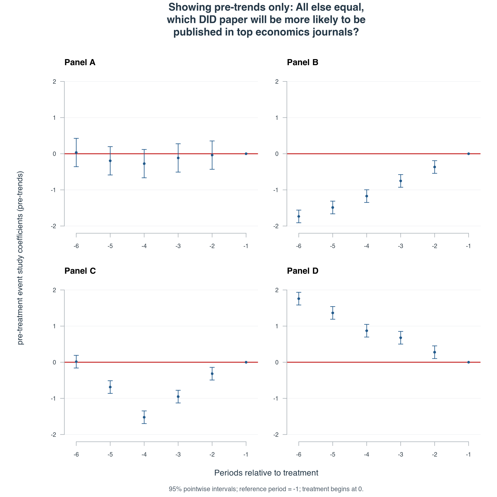
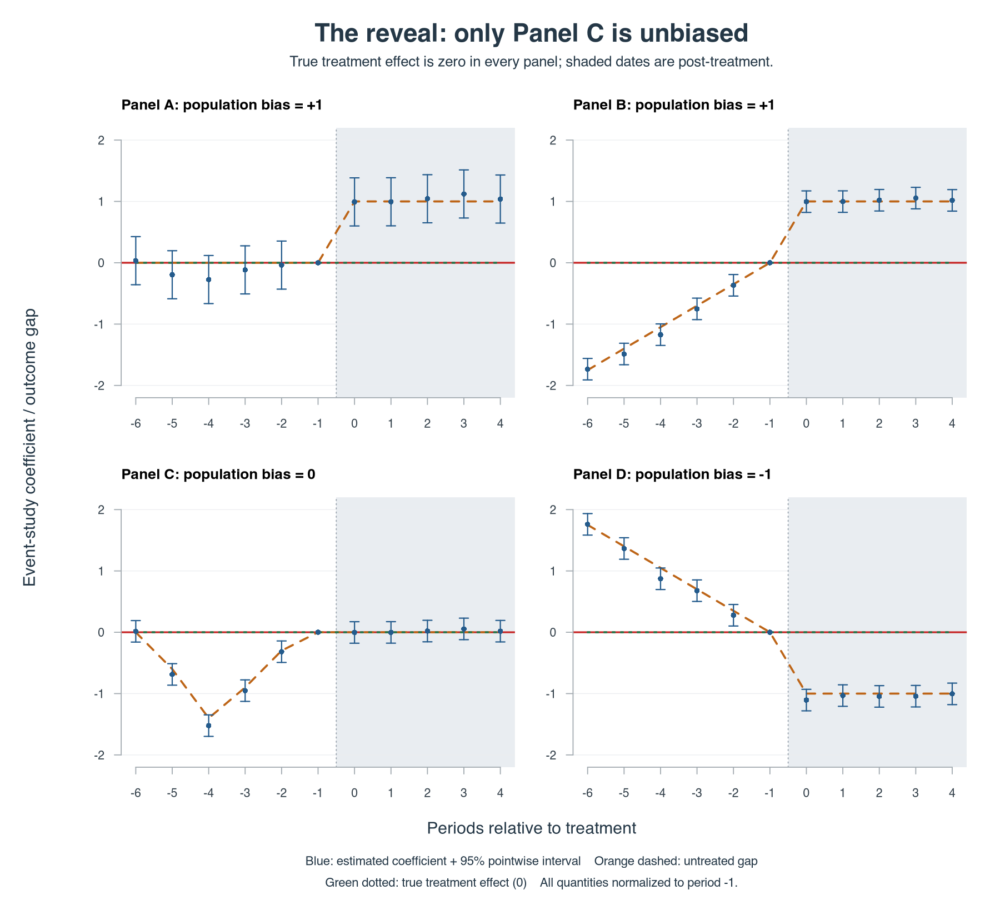
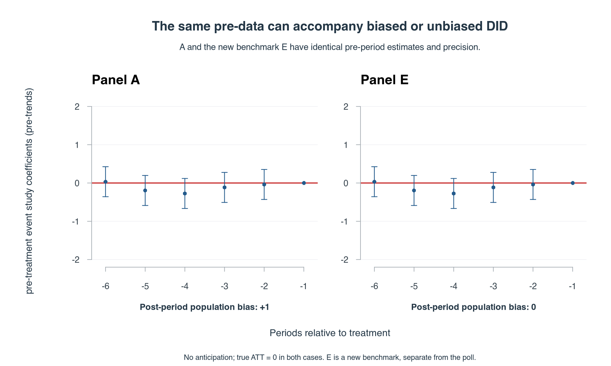
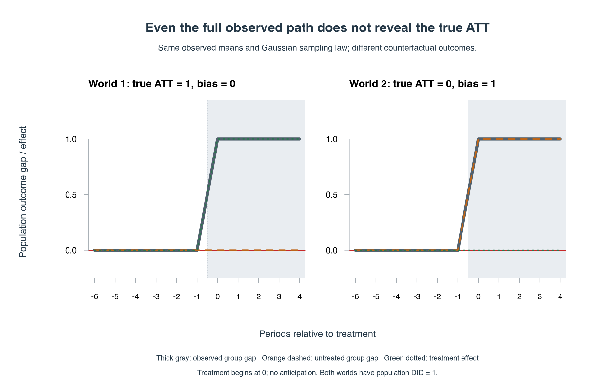

::: {.post-crosslink}
[Read on Substack](https://methodsmatter.substack.com/p/why-are-your-pre-trends-always-parallel){.button}
:::

> Econometric theory is like an exquisitely balanced French recipe, spelling
> out precisely with how many turns to mix the sauce, how many carats of
> spice to add, and for how many milliseconds to bake the mixture at exactly
> 474 degrees of temperature. But when the statistical cook turns to raw
> materials, he finds that hearts of cactus fruit are unavailable, so he
> substitutes chunks of cantaloupe; where the recipe calls for vermicelli he
> uses shredded wheat; and he substitutes green garment die for curry,
> ping-pong balls for turtle's eggs, and, for Chalifougnac vintage 1883,
> a can of turpentine.

— Stefan Valavanis (1959, p. 83), quoted in Peter Kennedy,
[*A Guide to Econometrics*, fifth edition, Introduction, p. 2](https://www.blackwellpublishing.com/content/BPL_Images/Content_store/Sample_chapter/1405115025/Kennedy-001.pdf) [-@kennedy2003].

Since I left graduate school, I have been fascinated by two questions when folks do difference-in-differences (DID): why do most top-tier published DID studies always have parallel pre-trends? Moreover, what exactly do we learn from such pre-trends graphs? To date, I have not received a convincing answer.

> For those who are in a hurry, I will cut to the chase: I believe that most published papers we see with flat pre-trends started out with some non-parallel pre-trends and the researchers worked their way to a flat one. Why? That's the incentive structure we created: if you  don't have flat pre-trends, no serious economics journal will publish your paper. When flat pre-trends become a publication condition, researchers are rewarded for finding specifications that produce them, while studies that cannot produce them face obstacles to publication.

> But why do the journal editors and reviewers create this incentive? Because they do not understand the identifying assumptions required by the DID design. Actually, that's too charitable: they are smart enough to understand it; they are just too lazy to engage with authors in the difficult business of providing a range of evidence for the validity of an untestable identifying assumption. There is **no way** to test DID's identifying assumptions. Flat pre-trends are neither necessary nor sufficient for the validity of DID's identifying assumptions. Deal with it.

> But doesn't a flat pre-trend provide some indirect information about the credibility of the identifying assumptions? **No**, not about the post-period counterfactual, because anyone making that argument needs to state the connection between the observed past and the untreated future, which means they'll need to make additional assumptions beyond the standard identifying assumption in question here.

> Well, but what if I genuinely find flat pre-trends without any specification searching at all? Good for you---I am happy for you and proud of you. But you're not special and you should save your holier-than-thou attitude for another day. Your genuine flat pre-trends do not confer any special advantages for your DID analysis because the flat trends occurred where we don't necessarily need them: the pre-period. So, hold your horses and still proceed cautiously.

> So, what do you suggest? I think we need an immediate moratorium on requiring flat pre-trends for publishing DID papers. But how can we establish with certainty that the identifying assumption holds? We cannot establish it from the observed data alone. **That limitation has to be faced. Deal with it.** That's what it means to have an **untestable** identifying assumption. What are our options? We must develop other ways of learning about the robustness of the DID estimates regardless of whether we see pre-trends or not. Until we do so, believe DID estimates at your own risk. If you are still unconvinced, read on.

The more I thought about this issue, the clearer it seemed to be that DID folks are wrestling with an impossible question: **how do you provide evidence for an assumption you cannot fundamentally test?** For this note, I am going to maintain the no-anticipation effects assumption (treatment does not affect outcomes before it begins); relaxing it only enhances my arguments and folks are not ready to deal with it yet. So we will pick up no-anticipation at a later time. DID's well-known key identifying assumption concerns how the treated group's outcomes would have changed without treatment.

The parallel trends assumption states that, in the absence of treatment, the treated and comparison groups would have experienced the same average change in outcomes from the last pre-treatment period to each post-treatment period. After treatment begins, those untreated outcomes are missing. **We need an argument for the counterfactual. The argument will never prove the assumption is satisfied and we can never test this assumption. Any evidence we offer in service of the validity of the post-period parallel trends will never be bulletproof.** Sadly, the indirect evidence or argument the economics profession has settled on is **one pretty picture: the pre-trends graph**. If anyone has a reference for the very first economics paper that made the case for predominantly requiring pre-trends figure, I would love to know about it! Please send it to me!

But why are you so riled up about this pre-trends graph? Well, you will never find any econometrician who believes the pre-trends graph provides the evidence researchers think it does. I am making no new point here. The profession simply decided to take the **easiest** possible path to answering the impossible question (again): **how do you provide evidence for an assumption you cannot fundamentally test?** The econometrics literature is explicit that the identifying post-period parallel trends assumption is untestable. **This point is central to my argument.** Some examples:

Baker, Callaway,
Cunningham, Goodman-Bacon, and Sant'Anna
[-@baker2026, p. 511] write:

> Assumption PT is fundamentally untestable, as it contains an unobserved
> counterfactual component.

Ghanem, Sant'Anna, and Wüthrich
[-@ghanem2026, p. 65]
are equally direct:

> Assumption PT is fundamentally untestable.

Both papers clearly distinguish the identifying assumption from what we can observe before treatment. And this distinction is where my question starts: **what does the pre-trends graph add to the case for the missing counterfactual?**

Kennedy's discussion captures the art involved in making that argument.
Applied econometrics requires judgment about the data, institutions, and
assumptions that make a comparison credible. I worry that this is a **lost** art because we are too busy chasing a reassuring pre-trends graph, which has become a routine/mandatory credential for a DID paper. What really does the figure establish? What does requiring it really encourage
researchers to do?

I recently [posted four pre-trends graphs on LinkedIn](https://www.linkedin.com/posts/augustinedenteh_imagine-four-standard-difference-in-differences-share-7516511855553593344-eaEf/)
and asked which one may get a paper published at the margin in economics. Take a look at the comments and notice the wide range of beliefs about the implications of the parallel trends assumption. By October 17, 2026, my LinkedIn analytics showed nearly **42,000 impressions**. The discussion raised questions about precision, identification, and what the current peer review system rewards. I want to highlight one comment at the outset:

> As a mathematician, my impression is that economists tend to go for the boring models. The comments here add to that impression. Why not use richer models and try to capture the actual underlying structure in B, C and D, rather than preferring A simply because it behaves nicely? Nicely behaved models go to journals. The others have to survive the real world. (Kalliopi Kleisarchaki)

This is a beautiful comment. Read it again and again. Let it sink in deeply. The question in my LinkedIn post is about selection. If a pretty pre-treatment
picture helps a paper get published on the margin, researchers have incentives to find
one. If they cannot find a clean pre-trends graph, they will shelve a study. Many of us know that the starting point for how several professors advise graduate students is to ask if the students have done any exploration to see how the pre-trends are looking. But why? Why does it matter? Well, what they are hinting at is that a flat pre-trend will be required for publication. If you think they are asking about the pre-trends to "use richer models and try to capture the actual underlying structure" you are deluding yourself. Next time you read a DID paper, ask yourself which selected specifications the author has brought to the reader and which they left out and why.

::: {.reaction-gif}
{.reaction-media width=320 height=240 loading=lazy decoding=async fig-alt="Homer Simpson backs into a hedge until he disappears."}

*Another study enters the file drawer.*

:::

Here are the four panels from my LinkedIn post. I asked people to hold the research question,
novelty, economic importance, and name recognition approximately equal, and
assumed no anticipation. **Which one panel (A/B/C/D) do you think would be more likely to be published at a relatively good economics journal at the margin?** In these simulated panels, only the pre-period trends are shown. Each panel has its own post-treatment paths and different realized post estimates.

{width=1800 height=1800 loading=lazy decoding=async fig-alt="Four simulated pre-treatment event studies labeled A through D. Panel A is approximately flat and less precise; B rises toward zero, C has a temporary dip, and D falls toward zero."}

*Figure 1. Only pre-treatment coefficients are shown. Treatment begins at date
0; date −1 is the reference, or baseline for measuring changes. Bars are 95%
pointwise intervals using known Gaussian variances: each interval concerns one
coefficient, rather than the whole path simultaneously. The examples assume no anticipation.*

Several comments illustrate the different arguments readers brought to the
figures. Jeffrey Harris preferred A: “Cleaner pre-trend suggests stronger
match.” Zehra Farooq questioned A's precision and favored B or D for bounding
the differential trend. Caleb Stroup considered D when the post-treatment
effect is positive, reasoning that its pre-trend would work against the
effect; they also noted that “A does feel safe though…”. Timothy Taylor argued
that explaining pre-existing patterns well could itself strengthen a paper.

## OK, tell us the truth about these panels

In these simulations, **C is the only case among A through D with an unbiased
DID estimator**. The actual treatment effect is zero in every case. The population DID estimate
is 1 in A and B, zero in C, and -1 in D.

Here, ATT means the average treatment effect on the treated. The population DID
estimate is the estimator's expectation over repeated samples. Bias is that
expectation minus the true ATT; it is different from the error in any one
realized estimate.

| Panel | Population pre-treatment pattern | True average treatment effect | Population DID estimate | Bias |
|:--|:--|--:|--:|--:|
| A | Flat | 0 | 1 | 1 |
| B | Rising toward the reference | 0 | 1 | 1 |
| C | Temporary dip, returning to the reference | 0 | 0 | 0 |
| D | Falling toward the reference | 0 | −1 | −1 |

The full paths show why. In this simulation, we exactly know how the treated group's outcomes
would have evolved without treatment because we made it up here. **These untreated potential outcomes are exactly what we cannot observe for the treated group after treatment in an
actual application.**

{width=1800 height=1620 loading=lazy decoding=async fig-alt="Full event studies for A through D, showing the known untreated population gaps and the zero true treatment effect. A and B have positive post-treatment bias, C is unbiased, and D has negative bias."}

*Figure 2. The figure shows the counterfactual paths known to us because we made it up in the simulation. All true treatment effects are zero.*

These are separate, deliberately constructed data generating processes (DGPs). They
are not four specifications chosen by an analyst working with the same data. The above construction makes two familiar points clear. **An attractive pre-period
graph can be consistent with a biased DID estimator. An unattractive graph can be consistent
with an unbiased DID estimator.**

> C's pre-period dip has disappeared by the reference date,
and the untreated group gap stays at its reference value throughout the post
period. If a DID paper presented pre-trends looking like C, good luck getting it published no matter the other pieces of evidence you send along with it. **Herein lies my argument: the pre-trends graph cannot, by itself, establish whether post-period parallel trends holds. We cannot observe the missing counterfactual. The assumption is untestable---we will never know; we will never know!** Have I shouted and screamed this loud enough?

::: {.reaction-gif}
{.reaction-media width=244 height=284 loading=lazy decoding=async fig-alt="Michael Scott says, How the turntables, in The Office."}

*Plot twist: C's DID estimator is the only unbiased one.*

:::

B's and D's histories lead to different post-period comparisons.
None of these patterns involves anticipation: treatment has no effect before
date 0, or indeed after it, in this example.

These warnings are established in the literature. Kahn-Lang and Lang [-@kahnlang2020] explain why parallel
pre-trends are neither necessary nor sufficient for the relevant post-period
assumption. Ghanem, Sant'Anna, and Wüthrich [-@ghanem2026] study the
connection through selection into treatment, including cases without a
structural break in the outcome process. My simple simulated paths just help to illustrate
the logical distinction to those in doubt.

## Which parallel trends assumption does DID rely on?

Let treatment start at date 0, and use date −1 as the reference. The comparison
group remains untreated. Let $D=1$ identify the treated group and $D=0$ the
comparison group. Write $Y_t(0)$ for the outcome a unit would have at date $t$
without treatment. The treated-minus-comparison difference in mean
**untreated potential outcomes** is

$$
\delta_t = E[Y_t(0)\mid D=1] - E[Y_t(0)\mid D=0].
$$

Assume no anticipation and no spillovers into the comparison group. For a
post-treatment date, let $\tau_t$ denote the average treatment effect for the
treated group. The population event study coefficient, $\beta_t$, is the change
in the treated-minus-comparison mean outcome gap from date −1 to date $t$. It satisfies

$$
\beta_t = \tau_t + \delta_t - \delta_{-1},\qquad t\geq 0.
$$

The DID estimator identifies $\tau_t$ when
$\delta_t=\delta_{-1}$. In words, absent treatment, the two groups would have
experienced the same change from the reference date to the post-treatment
date. Many unknown outcome paths can be accommodated between these two points---the reference date and the specific post-treatment date. The target in these simulations is the treated group's average effect over
dates 0 through 4. Its population DID bias is

$$
\overline\beta-\overline\tau
=\frac{1}{5}\sum_{t=0}^{4}(\delta_t-\delta_{-1}).
$$

The bars denote simple averages across the five post-treatment dates.

Pre-treatment event study coefficients, often called leads, concern earlier differences,
$\delta_s-\delta_{-1}$ for $s<-1$. Obviously, the pre-treatment event study coefficients alone do not tell us anything about the untreated post-period gaps on the right side of this equation. If you want to make an extrapolation, you need an explicit restriction connecting the earlier and later gaps, and this should be a clearly spelled out restriction beyond the usual DID identifying assumptions.

This distinction matters. Some folks use “parallel trends” for a restriction
over the entire pre- and post-treatment sample, and those folks should say so explicitly. In the standard DID setup here, the question at hand for the validity of the identifying assumption is whether the **post-period restriction needed to identify the chosen ATT** holds,
relative to the specified reference date. Panel C satisfies that restriction at
every post-treatment date. Its zero average bias does not arise from positive
and negative violations canceling out. Panel C's nonparallel pre-trends do not invalidate its post-period comparison. Indeed, the pre-trends in Panel C can only mislead us to discard an unbiased DID estimator in this scenario.

## Of course, the same pretty pre-trends may be consistent with an unbiased DID estimate

It would be silly to turn the opening into a different visual rule: **distrust flat leads and prefer a dip (like in Panel C)**. That would repeat the same mistake. The key message here is that if you are presented with any kind of pre-trends, such evidence cannot prove the parallel trends assumption where you need it---in the post period.

Consider a fifth example, E. Give it exactly the same pre-treatment population path,
sample size, realized errors, and estimated leads as A. In E, however, the
untreated group gap remains zero after the reference date. Its true effect is
zero and its DID estimator is unbiased. However, Panel A's population bias remains 1.

{width=1800 height=1080 loading=lazy decoding=async fig-alt="Panels A and E have identical estimated pre-treatment coefficients and intervals. The labels identify A's population bias as one and E's as zero."}

*Figure 3. Identical pre-treatment evidence, different post-period validity.*

> Together, the examples cover all four combinations: flat or nonflat population pre-trends, with valid or invalid post-period comparisons. Even complete knowledge of the population pre-path would leave the A-versus-E distinction unresolved without an additional assumption linking that path to the future.

The finite-sample issue adds another dimension. Panel A's estimated leads are not exactly
zero. Each individual interval includes zero, but individual non-rejection is different from a joint test. A joint pre-test tests whether all nonreference pre-treatment coefficients are zero together. Roth [-@roth2022]
shows how low power and conditioning on a pre-test can undermine estimation
and inference.

## Seeing the post-treatment estimates does not tell you the true effect

Some readers may think that seeing the post-period event study estimates would help them choose which panel to believe. Well, it might change their ranking, but they may still be mistaken. Even the complete graph cannot, on its own, tell them which estimator is unbiased. **The missing counterfactual remains missing.**

Suppose the observed group gap is zero before treatment and 1 afterward.
There are at least two possible explanations. In the first, the untreated gap
would have stayed at zero, and treatment raises the treated group's outcomes
by 1. In the second, treatment has no effect, and the untreated gap would
have risen by 1 anyway.

{width=1800 height=1152 loading=lazy decoding=async fig-alt="Two worlds have identical observed pre- and post-treatment gaps. In one, the post-treatment difference is a treatment effect of 1; in the other, it is an untreated counterfactual gap of 1 and the effect is zero."}

*Figure 4. Identical observable outcomes can have different counterfactual
decompositions.*

We can give both worlds the same entire observable stochastic process,
including the same realized outcome shocks. Every statistic computed from
the observed data then has the same distribution. The true ATT is 1 in the
first world and zero in the second. This is an identification problem even
with an arbitrarily large pre-treatment sample. **The above graph cannot separate the two explanations because the post-treatment untreated outcome for the treated group is missing!**

::: {.reaction-gif}
{.reaction-media width=360 height=203 loading=lazy decoding=async fig-alt="Pam Beesly says they are the same picture in The Office."}

*Same observed data. Different treatment effects.*

:::

## Does another assumption answer the question?

One answer is to impose a model connecting the past to the untreated future.
Suppose the untreated group gap follows $\delta_t=a+bt$ both before and after
treatment, where $a$ is the intercept and $b$ the slope. The population pre-data identify the slope $b$. If that slope is
zero, the model implies post-period parallel trends. The assumption that the
same linear law continues after treatment helps us do the extrapolation.

These are additional modeling arguments. **If the defense of a pre-trends graph is that we should first assume a particular connection between pre- and post-treatment outcomes, the question has changed.** Such an additional modelling connection needs to be stated and defended. Otherwise, I think we are just moving the goalposts.

Note that conditioning on covariates does not change the arguments here. A credible
conditional DID argument needs a post-period restriction at the relevant
covariate values and aggregation to the treated
population's ATT. An adjusted graph with flat pre-trends does not provide those
conditions.

Everything so far points to sensitivity analysis in DID analysis. For instance, Rambachan and Roth [-@rambachanroth2023] allow departures from exact parallel trends
and impose explicit restrictions relating possible violations across periods.
Those restrictions can be weaker than exact parallel trends and provide useful bounds and
inference. Their question is what causal conclusions survive under stated
restrictions.

> In the near future, I will return to sensitivity analysis as a possible foundation for a better publication standard. I want an immediate end to flat pre-trends as a condition for publication. I believe sensitivity analysis can keep the pre-trends estimates---regardless of how they look---and make the assumptions connecting them to the untreated future explicit and transparent.

## What are the strongest defenses put forward for the pre-trends graph?

What can we defend about using pre-trends graphs without adding a restriction connecting earlier outcomes to the untreated post-period? I believe three arguments deserve attention.

**Transparency.** Showing the estimated outcome history lets readers see
earlier differences, their magnitudes, and their precision. This is a good reason
to disclose the history. However, it supplies no rule for ranking A and E, which have
identical pre-data and different post-period validity. Transparency and
identification are distinct issues. The case for disclosure also needs to
confront how to incentivize truthful disclosure given publication incentives.

**Diagnosis.** A graph can show us an estimated divergence or instability that
deserves further investigation. Raw outcome plots can help show whether the movement
comes from the treated group, the comparison group, or both. These observations can prompt questions about measurement, composition, or the economic setting, but
they do not identify the cause of a pattern. **I am sympathetic to this argument of using pre-trends for diagnosis. I just feel we don't adequately use these findings to inform a robust DID estimation.**  Panel C makes the limit concrete: its earlier dip does not invalidate its post-period comparison. Conversely, A's quiet history does not show its later counterfactual divergence. A diagnostic prompt becomes evidence about post-period parallel trends only through an argument about the process generating the pattern. Better still, if the diagnosis can inform robust estimation, why not?

**Timing.** The full event study shows whether observed differential movement
appears to change around treatment. Roth, Sant'Anna, Bilinski, and Poe
[-@rothetal2023, Section 4.6 of the January 2023 draft] explicitly
give this as a reason to retain the plots, **alongside power, sensitivity, and contextual analysis (the latter 3 things do not get enough attention in DID analysis)**. This argument concerns the full event study, including
the post-period. Nonetheless, Figure 4 shows its limit: identical observed timing can arise
from a treatment effect or an untreated counterfactual divergence. Assigning
the break to treatment still requires the researcher to make the identifying argument.

These are good reasons to inspect and disclose outcome histories. They do not
prove the post-treatment identifying restriction holds. The standing question is
whether these narrower uses justify making a pretty figure a routine
publication requirement. I think not.

## Why require the figure?

The identification problem brings us to a question about the profession: what does this reporting requirement encourage researchers to do? We have seen why the graph cannot settle the counterfactual. We now need to ask what happens when producing a pretty version becomes a condition for publication. Suppose a pretty figure becomes an informal condition for taking a DID paper seriously. Researchers may respond by shelving studies with concerning pre-trends or choosing comparison groups, covariates, samples, and windows that make them look better.

::: {.reaction-gif}
{.reaction-media width=294 height=200 loading=lazy decoding=async fig-alt="Gandalf strikes his staff on the bridge to block passage in The Lord of the Rings."}

*No flat pre-trends? You shall not pass.*

:::

This possibility is central to my concern about the current state of routine pre-trend requirements. Calling the figure descriptive does not address the incentives for chasing a pretty graph. We need to ask whether the
information provided by the requirement justifies the selection and specification search
it may induce, compared with feasible alternatives.

In closing, (1) we need to put the evidence in DID papers on a lower pedestal because of the bad incentives we have created by the flat pre-trends requirement, (2) we need to have an immediate moratorium on the requirement to show flat pre-trends as a condition for publication: we need to get comfortable with the idea that DID estimates depend on an untestable assumption and multiple kinds of evidence need to be stated and presented clearly, including any remaining uncertainty, and (3) I plan to return shortly with some ideas for robust identification and sensitivity analysis in DID. Be on the lookout!

::: {.post-subscribe}
[Subscribe on Substack](https://methodsmatter.substack.com/subscribe){.button .primary}
:::

## References

::: {#refs}
:::
